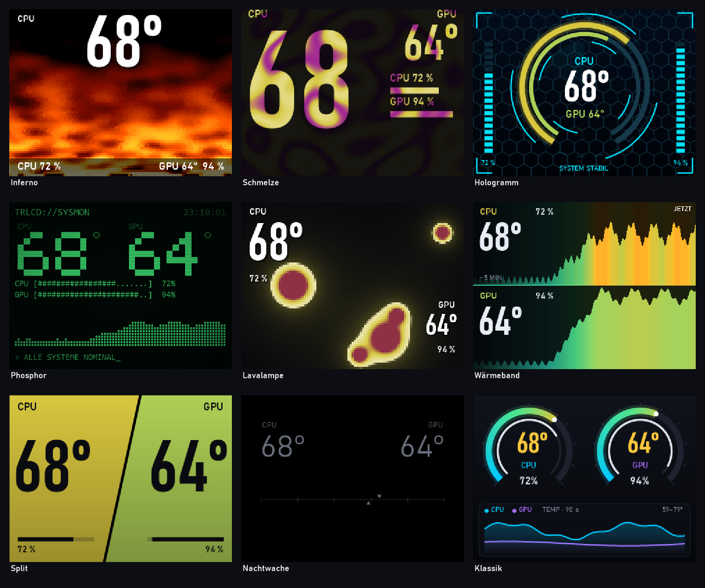

# Ultra Light RGB Control

CPU and GPU temperature on your AIO's LCD and on your RGB lighting, from a single background process
for Windows. No vendor suite, no tray icon, no account, no telemetry, nothing that stays in memory
except the one service.



## What it does

- **LCD themes.** Nine designs for the 320x240 panel, from a calm gauge to a fire simulation. The
  switcher in the Start menu shows live previews, picks one and exits again.
- **LEDs follow the theme and the temperature.** Each theme brings its own colours; they shift as the
  CPU or GPU heats up, and from 85 °C every theme turns to an alarm colour.
- **Lightweight on purpose.** Sensors are read once per second, LED colours are smoothed, and a
  static look is only written when it changes. Nothing is ever saved to a device: remove the tool
  and your hardware falls back to its own settings once it loses power.

## Footprint

Measured on a Ryzen 7 9800X3D (16 threads) with LCD, mainboard and GPU lighting active, averaged
over 30 seconds:

| Theme | CPU (whole system) | Private memory |
| :--- | :--- | :--- |
| Classic (1 frame per second) | 0.15 % | 46 MB |
| Inferno (fire simulation, about 12 frames per second) | 0.42 % | 44 MB |

## Supported hardware

| Kind | Device | Status |
| :--- | :--- | :--- |
| LCD | Thermalright AIO display `0416:5302` (320x240) | verified |
| Mainboard RGB | ASUS AURA USB `0B05:19AF` (ROG STRIX B650E-F) | verified on this board |
| GPU RGB | MSI RTX 5070 Gaming Trio | verified, other cards are refused |
| Anything else | every device [OpenRGB](https://openrgb.org) supports, through its SDK server | experimental |

Details, test notes and how to add a device: [docs/devices.md](docs/devices.md).

## Requirements

- Windows 10 or 11, x64
- [.NET 8 Desktop Runtime](https://dotnet.microsoft.com/download/dotnet/8.0) (x64)
- For AMD CPU temperatures: the [PawnIO](https://pawnio.eu) driver, which LibreHardwareMonitor uses.
  Without it the CPU temperature stays empty and CPU-driven LEDs follow the GPU instead.
- Close the vendor's own LCD or RGB software: two programs writing to one device fight each other.

## Install

1. Download `UltraLightRgb-<version>-win-x64.zip` from [Releases](../../releases) and extract it.
2. Open PowerShell **as administrator** in the extracted folder and run:

   ```powershell
   powershell -ExecutionPolicy Bypass -File .\install.ps1
   ```

This copies the app to `C:\Program Files\UltraLightRgb`, registers the scheduled task
`UltraLightRgb` (runs as SYSTEM at boot, needed for the CPU sensor) and adds
**Ultra Light RGB Control** to the Start menu. To remove it: `.\uninstall.ps1` (add `-RemoveData` to
also delete configuration and logs).

## Configuration

Without a configuration file the verified hardware above is used. To change that, copy
`devices.example.json` from the install folder to `C:\ProgramData\UltraLightRgb\devices.json`
(admin rights needed) and restart the task. Every entry is one LED output:

```json
{
  "lcd": true,
  "outputs": [
    { "driver": "aura", "source": "cpu", "header": 0, "board": true },
    { "driver": "msi-gpu", "source": "gpu" },
    { "driver": "openrgb", "source": "cpu", "match": "fan" }
  ]
}
```

Invalid entries are skipped with a line in `C:\ProgramData\UltraLightRgb\logs\service.log`. A file
that is not valid JSON leaves all LEDs untouched rather than falling back to the defaults.

## Command line

```text
UltraLightRgb.exe --devices            supported hardware found on this machine (writes nothing)
UltraLightRgb.exe --openrgb-list       controllers of the configured OpenRGB servers
UltraLightRgb.exe --test-color FF0000  set every configured LED output to one colour
UltraLightRgb.exe --sensors            temperature and load sensors
UltraLightRgb.exe --help               all options
```

Stop the scheduled task before running the tool by hand, or both will write to the same devices.

## Safety

- No commit, save or EEPROM command is ever sent; every change is lost once the device loses power.
  Some boards keep standby power on after shutdown, so a full power cut may be needed.
- I2C writes to the GPU only happen on the exact card they were verified on.
- The OpenRGB connection is limited to the local machine, and the configuration that the SYSTEM
  service reads can only be changed by administrators.
- This is hobby software that talks to hardware through undocumented protocols. It comes with no
  warranty (see the licence); use it at your own risk.

## Building

```powershell
dotnet build UltraLightRgb.sln -c Release
dotnet test UltraLightRgb.sln -c Release
.\deploy\package.ps1        # release zip in dist\
```

## Licence

GPL-3.0-or-later, see [LICENSE](LICENSE). Libraries, protocol sources and trademarks:
[THIRD-PARTY-NOTICES.md](THIRD-PARTY-NOTICES.md).
